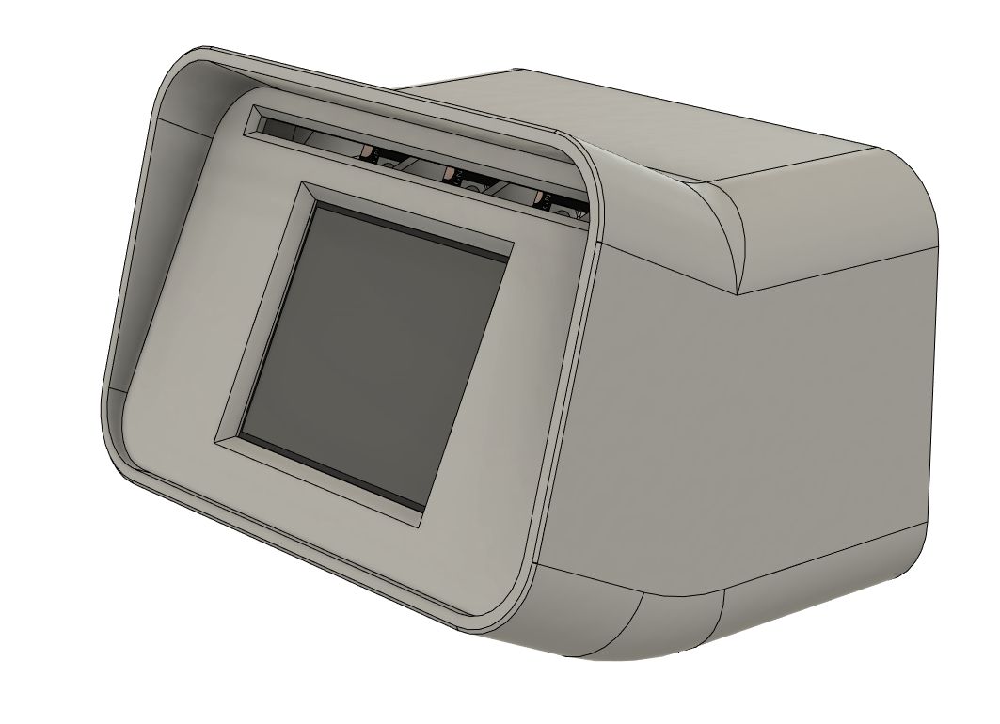

# MoonWatch

The Moonwatch is a project originating from the Klipper community that tries to realize something similar to the project "Printer Monitor" by Qrome.
It utilizes the moonraker API in order to gather information about your printer's current status and displays them in a comprehensive manner. 
Whenever it cannot reach your printer it simply shows a watch. 

The goal of the project is to make for an easy and cheap yet very useful and fun little project for all the Klipper lovers out there!

It has to be noted that this project is still in development and therefore everything is subject to change.

*** 

How to setup your watch see the [getting started guide](/docs/GettingStarted.md).

**Note:** Be aware this is an very early software state and there is no guarantee its working without any issues.

## Changes in this fork

- Flicker-free display: only changed values are redrawn, the screen is no longer wiped on every update
- Clock ticks smoothly; a failed NTP sync no longer resets the clock to 1970
- Printer data is kept for a few failed polls before falling back to the clock (no more short jumps to the clock)
- Cycling between printers no longer overwrites the data of the printer on screen
- Cancelled prints: LED blinks red for one minute
- LEDs of printers that are not on screen show a steady colour of their last known state
- WiFi dropouts are handled without flickering, with a retry every 15 seconds
- Fixed the web configuration page (printer counter, `storewifi()`)
- Pinned library versions in `platformio.ini`

Based on [the original MoonWatch project](https://github.com/rackrick/MoonWatch) by rackrick. Licensed under the GNU GPL v3, see [LICENSE](LICENSE).

# Enjoy!
